# compound-intake-demo
**Where AI belongs in compound-prescription intake: the gate goes where the irreversibility is.**

> Prototyped by Sabbir Hossain with AI coding assistants (Claude) under an architect-defined harness.
> Synthetic data. Fictional, illustrative formulas and limits. Not for clinical use.

## The problem
A compound prescription often arrives as free text, because the sending e-prescribing system doesn't send
structured compound ingredients. Someone has to work out which formulation the prescriber meant: which
actives, at what strength, in which base and dosage form. When it's unclear, a pharmacist phones the prescriber.

The user in this demo is the intake pharmacist at a fictional pharmacy, "SH Compounding Network", working a
queue that includes orders from a fictional telehealth partner, "TeleHealthSH", and from outside prescribers.
The demo helps with **interpretation only**. It doesn't calculate beyond-use dates, keep compounding records or
dispense anything.

## The principle
A wrong interpretation becomes a wrong compound, and dispensing can't be undone. So the human gate sits at the
one irreversible step: committing a decision.

- The model **proposes**. It turns free text into structured fields and writes a plain-language explanation.
- Code **decides what to show**. Deterministic, versioned rules raise the safety flags, and a scoring function
  in code ranks the formulas.
- A pharmacist **confirms, corrects or asks for clarification**. Only that action writes a committed record,
  to a hash-chained audit log.

Everything before the pharmacist's click is cheap to redo. Everything after it isn't, so nothing the model
produces can get there on its own.

## How it works

```mermaid
flowchart LR
    raw["Free-text prescription"] --> r1["Rules pass 1<br/>(raw text)"]
    r1 --> ext["LLM extract<br/>(strict tool schema)"]
    ext --> val{"Schema valid?"}
    val -- no --> manual["MANUAL<br/>(no candidates)"]
    val -- yes --> r2["Rules pass 2<br/>(fields vs library)"]
    r2 --> match["Matcher (code)<br/>score every formula"]
    match --> exp["LLM explain<br/>(reasons text only)"]
    exp --> prop["Proposal<br/>top 3 + confidence + margin + flags"]
    manual --> prop
    prop --> review["Pharmacist review<br/>CONFIRM / CORRECT / CLARIFY"]
    review --> audit[("Audit log<br/>hash-chained, append-only")]

    classDef llm fill:#fde68a,stroke:#b45309,color:#111;
    classDef code fill:#bfdbfe,stroke:#1d4ed8,color:#111;
    classDef human fill:#bbf7d0,stroke:#15803d,color:#111;
    class ext,exp llm;
    class r1,val,r2,match,prop,manual,audit code;
    class review human;
```

Yellow steps call the model, blue steps are plain code, and the green step is the pharmacist.

- **Rules pass 1** reads the raw text: empty or "see notes" descriptions, numbers with no unit, references to
  an unseen prior order, controlled-substance terms (an illustrative list), and instruction-like text aimed at
  the system (prompt injection).
- **LLM extract** fills a Pydantic schema through a strict tool. The prescription is wrapped as data, never as
  instructions. If validation fails, there is at most one retry, then the case goes to `MANUAL`.
- **Rules pass 2** checks the extracted fields against the formula library: unknown ingredient, strength above
  an illustrative maximum, a likely unit error (10× or 0.1× the nearest library strength), form/route conflict,
  missing or excessive quantity, missing prescriber or patient reference, duplicate ingredient.
- **Matcher** scores every formula: 0.40 ingredient-set similarity, 0.25 strength agreement, 0.15 dosage form,
  0.10 base, 0.10 route. Confidence is the top score and margin is top minus second. Below the match threshold
  the status is `NO_MATCH`. A small margin on a proposed match raises `M-01` (ambiguous, REVIEW).
- **LLM explain** writes reasons from the scored facts only. It has to cite the top formula, each of its
  component scores and every flag, or a deterministic fallback text is used instead. It can't change candidates,
  flags or status.
- **Review**: a `BLOCK` flag disables CONFIRM, so the pharmacist can only CORRECT (with a reason) or CLARIFY. A
  `REVIEW` flag needs an explicit acknowledgment before CONFIRM. There's no bulk action and no auto-confirm.
- **Audit**: an append-only SQLite table where each record's hash covers the previous one.
  `intake audit verify` recomputes the chain and reports the first broken link.

## What the AI does, and what it never does
| The model does | The model never does |
|---|---|
| Turns free text into structured fields (ingredients, strengths, form, base, route, quantity, prescriber, patient reference) | Pick the match or state a confidence: code scores every formula |
| Writes a plain-language explanation that cites the scores and flags | Raise, clear or downgrade a safety flag: flags come from versioned rules, and later stages can only add them |
| | Confirm anything: only a pharmacist's action commits a decision |
| | Write to the audit log: the LLM modules (`extract.py`, `explain.py`, `adapters/`) can't import `audit.py`, and an architecture test enforces it |
| | Get obeyed when the prescription says "ignore" or "approve": rule R1-05 fires on the raw text whatever the model does |
| | Run in CI: CI replays recorded responses, and a missing recording fails the build |

## Results (test split, 95% intervals, vs a no-LLM baseline)
From [results/2026-11-26.md](results/2026-11-26.md) (Mode: LIVE, run 1 of 3, model `claude-sonnet-5-5`),
generated by `eval/run_eval.py` over the locked golden set: 64 synthetic cases, 42 dev and 22 test. Thresholds
were tuned on dev only and frozen at Gate 2. Each cell is hits/cases, rate and a 95%
Wilson interval.

| Metric (test split) | System | No-LLM baseline |
|---|---|---|
| Field-level extraction accuracy | 153/176 87% [81–91] | n/a |
| Top-1 match accuracy | 16/19 84% [62–94] | 11/19 58% [36–77] |
| Top-3 match accuracy | 17/19 89% [69–97] | 13/19 68% [46–85] |
| No-match precision | 2/4 50% [15–85] | 2/8 25% [7–59] |
| No-match recall | 2/3 67% [21–94] | 2/3 67% [21–94] |
| Unsafe-flag recall | 3/3 100% [44–100] | 1/3 33% [6–79] |
| Ambiguity-flag recall | 2/2 100% [34–100] | 1/2 50% [9–91] |
| Ambiguity-flag false-alarm rate | 2/20 10% [3–30] | 3/20 15% [5–36] |
| Adversarial pass rate | 4/4 100% [51–100] | 4/4 100% [51–100] |
| Simulated override rate | 4/22 18% [7–39] | 9/22 41% [23–61] |

How to read this:
- **The baseline** is a rapidfuzz token-set match between the raw text and each formula's name and ingredients,
  plus the same pass-1 raw-text rules and the same M-01 rule. It extracts no fields, so it has no field accuracy
  and no pass-2 flags.
- **Hard gates** (CI fails if any is missed), over all 64 cases: adversarial pass rate 10/10, unsafe-flag recall
  10/10, schema-valid or `MANUAL` 64/64. All three passed in each of the 3 LIVE runs.
- **The intervals are wide.** The test split has 19 cases with a gold formula, so the top-1 intervals overlap
  (62–94 vs 36–77). On dev the two are close (32/37 vs 31/37), and the baseline's top-3 is higher (34/37 vs
  33/37). Treat the gap as suggestive, not precise.
- **The baseline isn't worse everywhere.** Over all 64 cases it gets top-1 right on 8/8 unsafe and 9/9
  adversarial cases, against the system's 7/8 and 8/9. The system's two misses (g044, g054) are `NO_MATCH`
  with BLOCK flags raised, so CONFIRM stays disabled either way.
- **The simulated override rate is a proxy.** The gold label stands in for the pharmacist, so it counts the
  cases whose decision (top-1 formula, `NO_MATCH`, or none) differs from the label. No pharmacist decision
  was measured.
- **The labels were written by a non-pharmacist** with AI help and spot-checked by the author. A label error
  shows up here as a system error, or hides one.
- **Run-to-run variance** over 3 LIVE runs: the decision differed between runs on 1/64 cases, the flag set on
  1/64, and extracted fields on 4/512 case-field pairs. Top-1 accuracy (all cases with a gold formula) was 48/56,
  49/56 and 49/56.
- **CI numbers** come from recorded responses (REPLAY), not from this LIVE run. On the test split they match the
  table above except two system cells: field accuracy 151/176 and ambiguity-flag false alarms 3/20 in REPLAY.

The case-by-case table, dev split and per-category slices are in the results file.

## Design decisions
- [ADR-0001: AI proposes, the pharmacist confirms](docs/adr/0001-ai-proposes-pharmacist-confirms.md). No code
  path from model output to a committed record, no auto-confirm at any confidence. The cost is pharmacist time
  on every case, so the benefit to measure is interpretation accuracy, not an automation rate.
- [ADR-0002: Deterministic rules own safety flags](docs/adr/0002-deterministic-rules-own-safety-flags.md).
  Flags are versioned rules, only ever added, and BLOCK disables CONFIRM. The cost is more false alarms, which
  are reported above as a metric.
- [ADR-0003: The LLM extracts; code scores the match](docs/adr/0003-matching-in-code-not-llm.md). The score is
  reproducible and auditable, and errors split into "extraction wrong" and "matching wrong". Matching quality is
  capped by the scoring function.

Smaller decisions, with dates and reasons, are in [DECISIONS-LOG.md](DECISIONS-LOG.md). The full specification
is [docs/SPEC.md](docs/SPEC.md).

## Limitations
From [docs/SPEC.md](docs/SPEC.md) §11, verbatim:

> Synthetic data; fictional, illustrative formulas and dose limits; labels written by a non-pharmacist with AI help and spot-checked by the author; small n with wide intervals; simulated override rate; no BUD, compounding record, sterile or veterinary logic; not clinical software.

Also known at the time of writing:
- The audit chain has no external anchor, so deleting the newest records leaves a shorter chain that still
  verifies.
- Which REVIEW flags a pharmacist acknowledged is enforced on the review screen but not yet stored in the audit
  record.
- One pinned model (`claude-sonnet-5-5`), one prompt version, one fictional library of 15 formulas. Nothing here
  says how another model or a real formulary would behave.
- There's no authentication: the reviewer name is whatever the user types.

## Run it (no API key needed)
Needs Python 3.12 and [uv](https://docs.astral.sh/uv/). Everything below runs in REPLAY mode from recorded
model responses in `eval/cassettes/`, so it needs no API key and makes no network calls to a model.

```sh
uv sync
make demo                                   # 3 showcase cases: clean, unsafe, prompt injection; writes no audit record
uv run pytest -q                            # the test suite
uv run python -m eval.run_eval --mode replay --enforce-gates --results-dir "$(mktemp -d)"   # golden-set eval
uv run intake run samples/case_001.txt      # one prescription end to end; logs a pending audit record
uv run intake audit verify                  # recompute the hash chain
make review                                 # the Streamlit review screen
```

`make demo` should end with "3/3 demo cases match their fixtures (mode REPLAY)". `intake run` writes to
`intake_audit.sqlite` (set in `config.toml`). The eval writes its results file to the directory you pass; without
`--results-dir` it writes to `results/` and can overwrite the committed file.

`RECORD` and `LIVE` modes call the Anthropic API and need `ANTHROPIC_API_KEY`. They're only used to make new
recordings and the final results run.

## How it was built
The code, tests and data were written by AI coding agents (Claude Code subagents: orchestrator, builder,
reviewer, data-author) working one GitHub issue at a time. The architect wrote the specification, the plan, the
invariants and the protected-path list, and approved each milestone gate. CI enforces the invariants: no import
path from the LLM modules to the audit log, REPLAY only, the hard eval gates, a redaction check, and a
protected-paths check.

- Process design: [docs/HARNESS_DESIGN.md](docs/HARNESS_DESIGN.md)
- What happened, per milestone (issues, fix rounds, reviewer catches, live calls): [docs/HARNESS.md](docs/HARNESS.md)
- Plan: [docs/PLAN.md](docs/PLAN.md)

MIT licensed. See [LICENSE](LICENSE).
